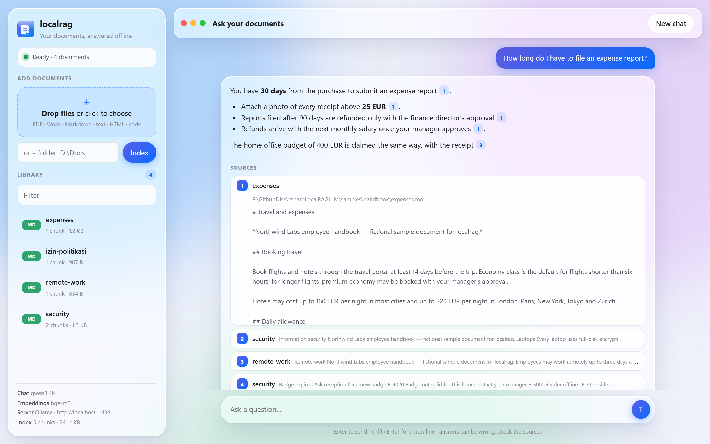
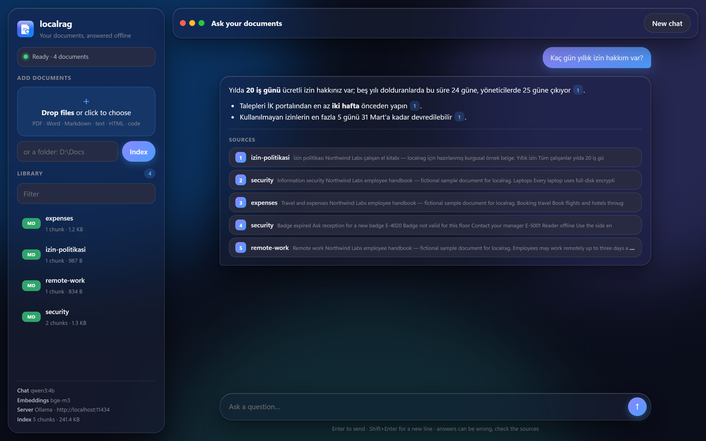
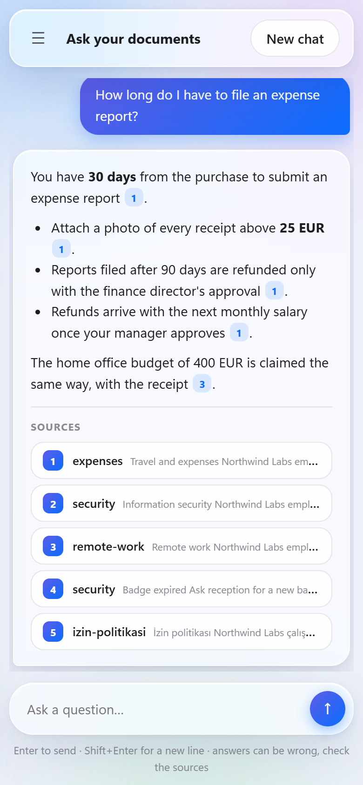
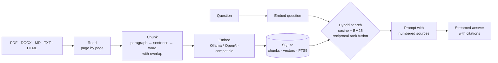

<div align="center">


# localrag

**Chat with your own documents, fully offline. A local RAG engine and app written in C#.**

Index PDF, Word, Markdown and text files, then ask questions in any language. Answers come only from your documents, with numbered sources, and nothing ever leaves your computer.

[](https://github.com/furkiak/csharpLocalRAGLLM/actions/workflows/ci.yml)
[](https://github.com/furkiak/csharpLocalRAGLLM/releases/latest)
[](https://www.nuget.org/packages/LocalRag)


[](LICENSE)

[English](#english) · [Türkçe](#türkçe)

<picture>
  <source media="(prefers-color-scheme: dark)" srcset="docs/images/web-dark.png">
  
</picture>

</div>

<a name="english"></a>

## Why localrag

- **Private by design.** Your files, the index and the models stay on your machine. No account, no cloud, no telemetry.
- **Answers you can check.** Every statement cites a numbered source; click it to see the exact passage, file and page.
- **Finds what you mean and what you typed.** Hybrid search combines embeddings with full-text BM25, so paraphrased questions *and* exact terms like `E-4012` or a customer name both work.
- **One tool, no stack.** No Python, no Docker, no vector database server. One .NET executable plus [Ollama](https://ollama.com) (or LM Studio, llama.cpp, vLLM…).
- **Fast to update.** Re-indexing skips unchanged files by content hash and removes files you deleted.

## Quick start

**1. Get the models** (once). Install [Ollama](https://ollama.com/download), then:

```bash
ollama pull qwen3:4b   # the chat model, ~2.6 GB
ollama pull bge-m3     # the multilingual embedding model, ~1.2 GB
```

**2. Install localrag**, either as a .NET tool (needs the [.NET 10 SDK](https://dotnet.microsoft.com/download)):

```bash
dotnet tool install -g LocalRag
```

or download the single-file app for Windows, Linux or macOS from the [latest release](https://github.com/furkiak/csharpLocalRAGLLM/releases/latest). It needs nothing else installed.

**3. Index and ask:**

```bash
localrag index ~/Documents/handbook
localrag ask "How long do I have to file an expense report?"
localrag serve --open        # the web app on http://127.0.0.1:5199
```

Want to try it right away? Clone the repository and index the sample handbook in [`samples/handbook`](samples/handbook) (four short fictional policies, one of them in Turkish).

```
$ localrag ask "How long do I have to file an expense report?"

You have 30 days from the purchase to submit an expense report [1]. Attach a photo of every
receipt above 25 EUR [1]; reports filed after 90 days need the finance director's approval [1].

  [1] expenses   samples/handbook/expenses.md
  [2] remote-work   samples/handbook/remote-work.md
```

## The web app

`localrag serve` starts a local web app with the same engine: drop files or index a folder, filter the library, ask follow-up questions and open the passage behind every citation. It follows your system's light or dark mode and works on a phone.

<p align="center">
  
  
</p>

The server listens on `127.0.0.1` only, refuses requests for other host names (DNS rebinding) and requires a custom header on every API call, so other websites you visit cannot use it. Uploaded files are stored next to the index in `~/.localrag/uploads`.

## Commands

| Command | What it does |
|---|---|
| `localrag index <paths…>` | Adds files or folders (recursively). Unchanged files are skipped, changed files re-embedded, deleted files removed. |
| `localrag ask "<question>"` | Answers one question with sources. `-k 8` gives the model more passages; `--no-sources` prints only the answer. |
| `localrag chat` | Interactive chat with follow-up questions. `/clear` starts over, `/exit` leaves. |
| `localrag search "<query>"` | Shows the best matching passages and whether they were found by meaning, by words or both. No model call. |
| `localrag list` | Lists indexed documents with pages, chunks and size. |
| `localrag remove <path>` | Removes a file or every document under a folder from the index. Your files are not touched. |
| `localrag reindex` | Re-embeds everything, for example after switching the embedding model. |
| `localrag doctor` | Checks the server, the models and the index, and tells you the exact command to fix each problem. |
| `localrag serve [--port 5199] [--open]` | Starts the web app. |

### Options and environment variables

| Option | Environment | Default |
|---|---|---|
| `--db <file>` | `LOCALRAG_DB` | `~/.localrag/index.db` |
| `--provider ollama\|openai` | `LOCALRAG_PROVIDER` | `ollama` |
| `--url <address>` | `LOCALRAG_URL` (or `OLLAMA_HOST`) | `http://localhost:11434`, or `http://localhost:1234/v1` for `openai` |
| `-m, --model <name>` | `LOCALRAG_MODEL` | `qwen3:4b` |
| `--embed-model <name>` | `LOCALRAG_EMBED_MODEL` | the model the index was built with, else `bge-m3` |
| — | `LOCALRAG_API_KEY` | none (sent as a Bearer token to OpenAI-compatible servers) |

Use separate `--db` files for separate collections, for example one index per project.

### LM Studio, llama.cpp, vLLM and other OpenAI-compatible servers

```bash
localrag --provider openai --url http://localhost:1234/v1 \
         --model qwen2.5-7b-instruct --embed-model text-embedding-nomic-embed-text-v1.5 \
         index ./docs
```

### Choosing models

| Use | Model | Notes |
|---|---|---|
| Chat, light | `qwen3:4b` | Good multilingual answers on 8 GB of RAM |
| Chat, better | `qwen3:8b`, `llama3.1:8b`, `gemma3:12b` | Slower, more precise |
| Embeddings | `bge-m3` | Multilingual (Turkish, German, French…), 1024 dimensions |
| Embeddings, English only | `nomic-embed-text` | Smaller and faster |

The chat model can be changed at any time. The embedding model is stored with the index; switching it requires `localrag reindex`, and localrag refuses to mix the two by accident.

## How it works



- **Reading.** PDFs are read page by page with [PdfPig](https://github.com/UglyToad/PdfPig); Word files straight from their XML (DTDs refused); HTML without scripts and styles.
- **Chunking.** About 1,200 characters with 200 characters of overlap, split at paragraph, sentence and word boundaries, never across pages. The document title and page are embedded with each chunk.
- **Storage.** One SQLite file holds documents, chunks, float32 vectors and an FTS5 index. Vectors are normalised and kept in memory for search, using SIMD (`TensorPrimitives`).
- **Retrieval.** The best 40 chunks by cosine similarity and the best 40 by BM25 are fused with reciprocal rank fusion; the top 6 become the sources.
- **Answering.** The model is told to use only the numbered sources, cite them and answer in the question's language. Follow-ups are searched together with the previous question.

## Use it in your own app

The engine is a library: [`LocalRag.Core`](https://www.nuget.org/packages/LocalRag.Core).

```csharp
using LocalRag;
using LocalRag.Ai;
using LocalRag.Store;

var (embedder, chat, _) = AiClients.Create(new AiOptions { ChatModel = "qwen3:4b", EmbeddingModel = "bge-m3" });
var engine = new RagEngine(new VectorStore("index.db"), embedder, chat);

await engine.IndexAsync("./docs");

var answer = await engine.AskAsync("What is the travel budget per night?");
foreach (var source in answer.Sources) Console.WriteLine($"[{source.Number}] {source.Label}");
await foreach (var token in answer.Tokens) Console.Write(token);
```

`IEmbedder` and `IChatModel` are small interfaces, so any other model backend can be plugged in.

## Good to know

- **Scanned PDFs** contain images, not text; run OCR first (for example `ocrmypdf`). Images inside documents are ignored.
- **Size.** Vectors live in memory while searching: about 4 KB per chunk with `bge-m3`, so 100,000 chunks need roughly 400 MB.
- **Answers can still be wrong.** Small models occasionally misread a passage. The sources are there so you can check.
- Files are not watched; run `localrag index` again (it is fast) when documents change.

## Development

```bash
dotnet build LocalRag.sln
dotnet test LocalRag.sln              # 57 tests: documents, chunking, AI protocols, store, engine, web API
dotnet run --project src/LocalRag.Cli -- serve --open
```

```
src/LocalRag.Core     reading, chunking, AI clients, SQLite store, hybrid search, RagEngine
src/LocalRag.Cli      the localrag command and the web app (Web/wwwroot)
tests/LocalRag.Tests  xUnit tests with fake models and a fake HTTP server
samples/handbook      fictional documents to try it out
```

Version 2.0 replaced the original Python prototype; see the [CHANGELOG](CHANGELOG.md).

## License

[GPL-3.0](LICENSE)

---

<a name="türkçe"></a>

## 🇹🇷 Türkçe

**localrag**, kendi belgelerinizle tamamen çevrimdışı sohbet etmenizi sağlayan, C# ile yazılmış yerel bir RAG motoru ve uygulamasıdır. PDF, Word, Markdown ve metin dosyalarınızı indeksler, sorularınızı herhangi bir dilde cevaplar. Cevaplar yalnızca belgelerinizden gelir, numaralı kaynaklarla gösterilir ve hiçbir veri bilgisayarınızdan çıkmaz.

### Neden localrag?

- **Gizlilik esastır:** dosyalar, indeks ve modeller bilgisayarınızda kalır. Hesap, bulut veya telemetri yoktur.
- **Doğrulanabilir cevaplar:** her bilgi numaralı bir kaynağa dayanır; kaynağa tıklayınca ilgili pasajı, dosyayı ve sayfayı görürsünüz.
- **Hem anlamı hem kelimeyi bulur:** hibrit arama, embedding benzerliğini tam metin (BM25) aramasıyla birleştirir. Farklı kelimelerle sorulan sorular da, `E-4012` gibi kodlar da bulunur.
- **Tek araç:** Python, Docker ya da ayrı bir vektör veritabanı gerekmez. Tek bir .NET uygulaması ve [Ollama](https://ollama.com) (ya da LM Studio, llama.cpp, vLLM…) yeterlidir.
- **Hızlı güncelleme:** yeniden indekslemede değişmeyen dosyalar atlanır, silinen dosyalar indeksten çıkarılır.

### Hızlı başlangıç

```bash
ollama pull qwen3:4b          # sohbet modeli
ollama pull bge-m3            # çok dilli embedding modeli (Türkçe dahil)
dotnet tool install -g LocalRag
localrag index ~/Belgeler/el-kitabi
localrag ask "Kaç gün yıllık izin hakkım var?"
localrag serve --open         # web uygulaması: http://127.0.0.1:5199
```

.NET kurmak istemiyorsanız Windows, Linux ve macOS için tek dosyalık uygulamayı [son sürümden](https://github.com/furkiak/csharpLocalRAGLLM/releases/latest) indirebilirsiniz. Hemen denemek için depodaki [`samples/handbook`](samples/handbook) klasörünü indeksleyin; içinde Türkçe bir izin politikası da var.

### Komutlar

| Komut | Ne yapar |
|---|---|
| `localrag index <yollar…>` | Dosya ya da klasör ekler (alt klasörlerle). Değişmeyenleri atlar, değişenleri yeniler, silinenleri çıkarır. |
| `localrag ask "<soru>"` | Tek bir soruyu kaynaklarıyla cevaplar. |
| `localrag chat` | Takip sorularıyla etkileşimli sohbet. |
| `localrag search "<sorgu>"` | Modeli çağırmadan en uygun pasajları gösterir. |
| `localrag list` / `remove <yol>` | İndeksteki belgeleri listeler ya da çıkarır (dosyalarınıza dokunmaz). |
| `localrag reindex` | Embedding modelini değiştirdikten sonra her şeyi yeniden işler. |
| `localrag doctor` | Sunucuyu, modelleri ve indeksi kontrol eder; her sorun için çalıştırılacak komutu söyler. |
| `localrag serve` | Liquid Glass tasarımlı yerel web uygulamasını başlatır. |

Ayarlar komut satırından (`--db`, `--provider`, `--url`, `--model`, `--embed-model`) ya da ortam değişkenleriyle (`LOCALRAG_DB`, `LOCALRAG_MODEL`, `LOCALRAG_EMBED_MODEL`, `LOCALRAG_URL`, `LOCALRAG_API_KEY`) verilir. LM Studio gibi OpenAI uyumlu sunucular için `--provider openai --url http://localhost:1234/v1` kullanın.

### Nasıl çalışır?

Belgeler sayfa sayfa okunur; paragraf, cümle ve kelime sınırlarından, örtüşmeli ve sayfa sınırını aşmayan parçalara bölünür. Her parçanın embedding'i Ollama ya da OpenAI uyumlu bir sunucudan alınır ve tek bir SQLite dosyasında (vektörler + FTS5 tam metin indeksi) saklanır. Soru geldiğinde kosinüs benzerliği ile BM25 sonuçları *reciprocal rank fusion* ile birleştirilir; en iyi 6 parça numaralı kaynak olarak modele verilir ve model yalnızca bu kaynaklara dayanarak, sorunun dilinde ve kaynak numarası vererek cevap yazar.

Motoru kendi uygulamanızda kullanmak için [`LocalRag.Core`](https://www.nuget.org/packages/LocalRag.Core) NuGet paketini ekleyin (yukarıdaki İngilizce bölümde örnek kod var).

### Bilmeniz gerekenler

- Taranmış PDF'ler metin değil görüntü içerir; önce OCR uygulayın. Belgelerdeki resimler okunmaz.
- Arama sırasında vektörler bellekte tutulur: `bge-m3` ile parça başına yaklaşık 4 KB (100.000 parça ≈ 400 MB).
- Küçük modeller zaman zaman yanılabilir; kaynaklar kontrol edebilmeniz için gösterilir.

Sürüm 2.0, eski Python prototipinin yerini aldı. Ayrıntılar [CHANGELOG](CHANGELOG.md) dosyasında. Lisans: [GPL-3.0](LICENSE).
