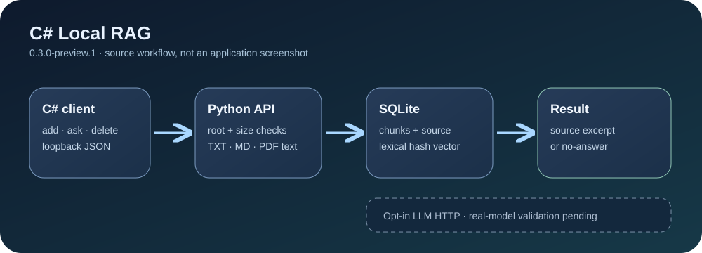

# C# Local RAG — grounded retrieval preview

**A reproducible C# client + Python API that returns a source excerpt or an explicit no-answer by default.** The demo indexes local TXT, Markdown and text-based PDF files in Chroma. It uses deterministic lexical hash vectors and an extractive answer, so no model weights or cloud API are needed for the first run. An opt-in generative mode calls a separately configured loopback llama.cpp-compatible server and checks its citation IDs. This is a teaching prototype, not a production semantic search or fact-checking system.



> **0.3.0-preview.2 · local source preview.** The earlier `LLMModel/` directory contains tokenizer/config files but **no model weights**. Default `/query` stays extractive. Actual Qwen2.5-1.5B / llama.cpp validation exposed missing citations; schema-constrained output fixes that format path. A dated working-source run matched 19/20 tailored examples, but generic and conflicting-source answers still failed review. Valid citation IDs do not prove that an answer is supported. Synthetic protocol tests and genuine model results are separate. See [local setup and observed limitations](docs/LOCAL_MODEL.md). Nothing is downloaded or started automatically.

## Quick start

Use Python 3.10 and .NET SDK 10. On Windows PowerShell, from a clean checkout:

```powershell
py -3.10 -m venv .venv
.\.venv\Scripts\python -m pip install -r requirements-dev.txt
dotnet build CSharpLocalRag.csproj -c Release
dotnet test CSharpLocalRag.Tests/CSharpLocalRag.Tests.csproj -c Release
.\.venv\Scripts\python -m pytest -q
.\.venv\Scripts\python eval/run.py
.\.venv\Scripts\python -m uvicorn app:app --host 127.0.0.1 --port 8000
```

Keep that terminal open. In another terminal in the same checkout:

```powershell
dotnet run --project CSharpLocalRag.csproj -- add samples/handbook.md example handbook
dotnet run --project CSharpLocalRag.csproj -- ask "What is the return period?"
dotnet run --project CSharpLocalRag.csproj -- ask "What is the shipping fee?"
```

The first question returns the exact `30 days` source sentence with `source_id`, relative path and chunk; the second returns `status: no_answer`. The sample handbook is synthetic. On Linux/macOS replace the first command with `python3.10 -m venv .venv` and use `.venv/bin/python` for Python commands. The C# project needs the .NET 10 SDK on the chosen platform.

`requirements.txt` pins tested **direct** dependencies, including NumPy 1.26 for Chroma 0.4.24; it is not a full transitive lock. The sample loads neither `torch` nor `transformers`. Python's package installer still fetches the pinned packages from the configured package index. Run `python -m pytest -q` and `python eval/run.py` after dependency upgrades.

## How the sample works

1. Put a UTF-8 TXT/MD or text-based PDF under `samples/`, or set `RAG_DOCUMENT_ROOT` to a dedicated local directory. Only files resolving inside that root are accepted. The API rejects other paths, unsupported formats, files over 2 MiB and PDFs over 50 pages. Scanned image-only PDFs have no searchable text and are rejected.
2. `POST /documents` extracts text, makes overlapping chunks, stores the **document text**, source metadata and deterministic vectors in local Chroma. Reusing an ID updates its chunks and removes stale ones. `DELETE /documents/{id}` removes them.
3. `POST /query` uses the same vector function for the question, then a lexical overlap gate. It returns a sentence copied from the best eligible chunk and its source reference, or `no_answer` when no chunk passes. A matching word is not proof of a correct factual answer; review excerpts before using them.
4. The C# CLI uses structured JSON and checks HTTP status. It allows only a loopback API URL, so adding a file cannot silently send its path to a remote endpoint.
5. `ask --mode generative --timeout 90 <question>` is optional. Only eligible retrieved excerpts are sent to the explicit literal-loopback endpoint. No retrieved source means no model call. The model must return completed JSON with supplied `S1`..`S3` citation IDs and a matching response model alias. Errors return `generation_error`, empty answer and exit 1; no extractive answer is silently substituted. A valid citation ID is not proof that the claim is true.

The API defaults to `127.0.0.1:8000`; don't bind it to a public interface. `RAG_DB_PATH` changes the local Chroma folder (default `.rag-data/`), and `RAG_API_URL` changes the C# client's **literal-loopback HTTP root**. Default retrieval keeps data in local Chroma; opted-in generation sends bounded question/excerpts to the configured loopback server, whose forwarding policy is outside this sample's control. Every program with access to this unauthenticated API can query indexed content. Use a dedicated sample directory, not private documents, for a demo.

Generation uses `RAG_GENERATION_URL`, `RAG_GENERATION_MODEL`, an adjustable 1..120-second deadline (default 30), and `RAG_GENERATION_KIND` (`unverified`, `synthetic_fixture`, `local_model`). The kind is **operator-declared, not real-model evidence**. The CLI defaults to a 45-second wait, allows `--timeout 1..180`, and propagates Ctrl+C to its HTTP request. The API/model server may continue until its own deadline; inference cancellation is not guaranteed. See the [EN/TR local model guide](docs/LOCAL_MODEL.md) for budgets, official llama.cpp/Qwen sources and licence boundaries.

## Evaluation and limits

`python eval/run.py` prints a 20-question extractive report: 12 expected source excerpts and eight explicit no-answer cases, in English and Turkish. The test suite changes one fixture fact to ensure the evaluation turns red. `--mode generative` explicitly uses the configured local server, but still scores only expected source/literal answer substring or explicit `no_answer`; model failures do not pass as no-answer. The fixture is small and tailored to literal overlap; its score does **not** predict retrieval/model quality on real documents.

Local source/protocol checks pass 42 Python cases and 13 C# cases, including four actual CLI → API → synthetic server flows (included in the Python count). Build the CLI first; otherwise those four explicitly skip. Source instructions are kept in an untrusted data block, and invented citations are rejected; this does **not** establish prompt-injection resistance or factual grounding of an actual model. Real-model runs, conflicting sources, paraphrases, wrong-but-existing citations, OCR, ranking quality and clean-machine packaging remain separate gates. This preview supports Chroma only.

Source changes are in [CHANGELOG.md](CHANGELOG.md); current release gates are in [docs/SUPPORT.md](docs/SUPPORT.md). The repository code remains [GPL-3.0](LICENSE). Existing `LLMModel/` metadata has its own Apache-2.0 license file; no weight file is bundled, downloaded or implied by this project.

## Türkçe

Bu örnek varsayılan olarak yerel belgelerden **doğrudan kaynak pasajı** ya da açık `no_answer` döndürür. `--mode generative` açık tercihle, ayrıca başlatılmış yerel HTTP model sunucusunu çağırabilir; kaynak yoksa model çağrılmaz, hatada sessiz/sahte cevap üretilmez. Kaynak kimliğinin geçerli olması cevabın doğruluğunu kanıtlamaz. `local_model` etiketi operatör beyanıdır; sahte HTTP testleri gerçek model sonucu sayılmaz. Depoda/pakette model ağırlığı veya runtime yoktur; lisansları ve hash'leri ayrıca doğrulanır. [Yerel model rehberi](docs/LOCAL_MODEL.md) ayrıntıları verir. 20 soruluk ölçüm eğitim amaçlıdır, gerçek kullanım başarısı kanıtı değildir.
